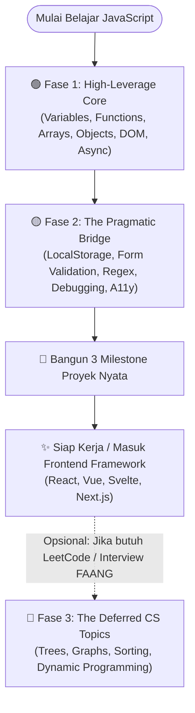

# 🗺️ 1. Peta Konsep & Analisis 26 Modul FCC v9

Dokumen ini membedah seluruh 26 modul kurikulum resmi **freeCodeCamp v9 JavaScript** dan mengelompokkannya menggunakan kacamata **Prinsip Pareto (80/20)**.

---

## 🧭 Alur Belajar Berbasis Efisiensi (Learning Flow)

---

## 📋 Tabel Audit 26 Modul freeCodeCamp v9

Berikut adalah klasifikasi rasional setiap modul pada kurikulum resmi freeCodeCamp v9:

| No | Nama Modul FCC v9 | Klasifikasi | Alasan Pemilihan & Tingkat Leverage |
| :-: | :--- | :---: | :--- |
| 1 | `Variables and Strings` | 🟢 Core | Dasar mutlak penyimpanan teks & manipulasi string dalam memori. |
| 2 | `Booleans and Numbers` | 🟢 Core | Pengendalian alur logika, evaluasi kebenaran, dan komputasi dasar. |
| 3 | `Functions` | 🟢 Core | Unit modular kode, `scope`, dan mekanisme *first-class functions*. |
| 4 | `Arrays` | 🟢 Core | Pengelolaan daftar data terurut yang digunakan di seluruh aplikasi. |
| 5 | `Objects` | 🟢 Core | Pemodelan entitas, struktur JSON dari API, dan manajemen *state*. |
| 6 | `Loops` | 🟡 Bridge | Cukup pahami `for...of`; 80% perulangan modern digantikan metode `array`. |
| 7 | `Review JavaScript Fundamentals` | 🟢 Core | Evaluasi konsolidasi pemahaman dasar. |
| 8 | `Higher Order Functions and Callbacks` | 🟢 Core | Fondasi mutlak JavaScript modern (`map`, `filter`, `reduce`). |
| 9 | `DOM Manipulation and Events` | 🟢 Core | Menghubungkan logika komputasi dengan layar antarmuka pengguna di peramban. |
| 10 | `JavaScript A11y` | 🟡 Bridge | Aksesibilitas web (`ARIA attributes`, fokus navigasi papan ketik). |
| 11 | `Debugging JavaScript` | 🟡 Bridge | Kemampuan melacak galat secara mandiri via Chrome DevTools. |
| 12 | `Basic Regex` | 🟡 Bridge | Pola pencocokan teks dasar untuk validasi masukan data formulir. |
| 13 | `Form Validation` | 🟡 Bridge | Menangani aksi `submit`, pencegahan muat ulang, dan sanitasi data pengguna. |
| 14 | `Dates` | 🟡 Bridge | Penanganan waktu dasar (`Date object`, formatting tanggal). |
| 15 | `Audio and Video Events` | 🔴 Deferred | Terlalu spesifik; hanya dibutuhkan bila membangun pemutar multimedia kustom. |
| 16 | `Maps and Sets` | 🟡 Bridge | Bermanfaat untuk koleksi unik (`Set`), tetapi `array` & `object` sudah memenuhi 80% kasus. |
| 17 | `Localstorage and CRUD Operations` | 🟡 Bridge | Persistensi *state* lokal tanpa perlu menyiapkan server *database*. |
| 18 | `Classes and the This Keyword` | 🟡 Bridge | Penting untuk memahami OOP, meskipun paradigma *functional* lebih dominan di frontend. |
| 19 | `Recursion` | 🔴 Deferred | Konsep akademis; rekursi mendalam jarang dipakai di antarmuka web standar. |
| 20 | `Data Structures (Stack, Queue, Linked List)` | 🔴 Deferred | Mengimplementasikan struktur data manual jarang dilakukan di dunia frontend industri. |
| 21 | `Algorithms (Searching and Sorting)` | 🔴 Deferred | JavaScript sudah memiliki `Array.prototype.sort()` yang teroptimasi di level *engine*. |
| 22 | `Graphs and Trees` | 🔴 Deferred | Konsep ilmu komputer murni; simpan untuk persiapan wawancara teknis. |
| 23 | `Dynamic Programming` | 🔴 Deferred | Sangat kompleks; pemula sering mengalami kejenuhan (*burnout*) di topik ini. |
| 24 | `Functional Programming` | 🟡 Bridge | Cukup pahami konsep *pure function* dan *immutability* praktis. |
| 25 | `Asynchronous JavaScript` | 🟢 Core | Jantung koneksi internet: `fetch`, `Promise`, `async`/`await`, penanganan API. |
| 26 | `JavaScript Review` | 🟢 Core | Evaluasi komprehensif seluruh konsep esensial. |

---

## 💡 Mengapa Banyak Pemula Mengalami Burnout?

Banyak pembelajar JavaScript menyerah di tengah jalan karena mencoba menuntaskan kurikulum secara linier dari modul 1 hingga 26 tanpa filter prioritas. 

Ketika tiba di modul **Recursion**, **Linked Lists**, atau **Dynamic Programming**, mereka merasa bahwa pemrograman JavaScript sangat rumit dan tidak realistis. Faktanya, **90% pengembang frontend profesional tidak pernah menulis fungsi rekursif rumit atau algoritma pohon biner dalam pekerjaan sehari-hari mereka**. 

Dengan memusatkan 80% perhatian Anda pada **Fase 1 (High-Leverage Core)** dan **Fase 2 (The Pragmatic Bridge)**, Anda dapat membangun portofolio aplikasi web fungsional dalam waktu sepertiga lebih singkat.

---

## ❓ Pertanyaan Evaluasi (Questions)

Berikut adalah kuis evaluasi pemahaman strategi belajar:

Manakah pernyataan yang paling tepat mengenai penerapan Prinsip Pareto dalam mempelajari kurikulum JavaScript v9?

- [ ] Kita harus menghapus permanen modul algoritma dan struktur data karena modul tersebut tidak pernah berguna dalam pemrograman komputer.
- [x] Kita memprioritaskan 20% konsep inti (`function`, `array methods`, `DOM`, `async/await`) untuk membangun produk nyata terlebih dahulu, dan menangguhkan materi algoritma teoretis ke tahap berikutnya.
- [ ] Kita harus menyelesaikan modul secara berurutan dari modul 1 hingga 26 tanpa melompati topik apa pun agar tidak kehilangan konteks historis.
- [ ] Kita cukup mempelajari HTML dan CSS saja karena JavaScript modern sudah tidak lagi dibutuhkan di era *artificial intelligence*.

Mengapa modul seperti `Dynamic Programming` dan `Graphs and Trees` dikategorikan sebagai *Deferred* bagi calon pengembang web frontend?

- [ ] Karena JavaScript tidak memiliki kemampuan untuk memproses struktur data graf dan pohon.
- [ ] Karena kedua materi tersebut merupakan materi usang yang telah dihapus dari standar ECMAScript terbaru.
- [x] Karena materi tersebut memiliki kurva belajar yang sangat curam namun menyumbang frekuensi penggunaan praktis yang sangat kecil (<5%) dalam pekerjaan frontend sehari-hari.
- [ ] Karena peramban web modern secara otomatis melarang eksekusi algoritma pencarian graf demi alasan keamanan data.

---

[⬅️ Sebelumnya](README.md) | [Selanjutnya ➡️](2-fase-1-high-leverage-core.md)
