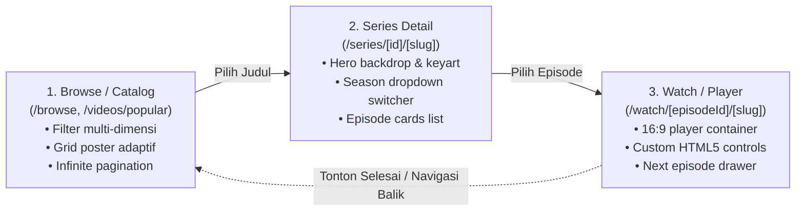

# Crunchyroll Frontend Architecture Blueprint (Educational Reference)

Dokumen ini merupakan cetak biru (_blueprint_) teknis komprehensif hasil rekayasa balik (_reverse engineering_) terhadap arsitektur web dan sistem katalog **Crunchyroll**. Dirancang khusus sebagai panduan arsitektur dan spesifikasi teknis untuk pembelajaran mandiri dalam membangun platform streaming video modern menggunakan **Next.js**, **TypeScript**, dan standar web modern.

---

## 1. Alur Inti Sistem (The Golden Path)

Dalam arsitektur frontend streaming, 95% interaksi pengguna berada pada siklus 3 halaman inti (_The Core Value Loop_):



---

## 2. Arsitektur Global & Autentikasi Tamu (2-Tier JWT)

Sebelum memuat data katalog apa pun, frontend melakukan pertukaran token anonim untuk mendapatkan hak akses membaca konten (_read-only_), mendeteksi negara/geolokasi, dan tingkat kedewasaan (_maturity level_).

### Alur Bootstrap Autentikasi:

1. **Endpoint**: `POST https://www.crunchyroll.com/auth/v1/token`
2. **Header**:
   - `Authorization: Basic Y3Jfd2ViOg==` (Didekode menjadi `cr_web:`, Client ID publik tanpa secret).
   - `Content-Type: application/x-www-form-urlencoded`
3. **Body**: `grant_type=client_id`
4. **Respons JSON**:

```json
{
  "access_token": "eyJhbGciOiJSUzI1NiIs...",
  "token_type": "Bearer",
  "expires_in": 3600,
  "scope": "account content mp offline_access",
  "country": "ID"
}
```

---

## 3. Spesifikasi Halaman 1: Browse / Catalog Page

- **Rute URL**: `/browse` ➔ redirect ke `/videos/popular` (atau `/videos/new`, `/videos/alphabetical`, `/simulcast`).
- **Tujuan Utama**: Menampilkan katalog serial/film anime dengan opsi filter multi-dimensi dan pengurutan dinamis.

### A. Hierarki Komponen UI

```
BrowsePage (app/[locale]/videos/[sort]/page.tsx)
├── MainNavigation (Header bar, logo, link simulcast/categories)
├── TitleWithDropdownsBar
│   ├── PageHeading ("Most Popular Anime" / <h1>)
│   ├── SortDropdown (erc-browse-sorting: Popularity, Newest, Alphabetical)
│   └── FilterPopover (erc-browse-filtering: Language Sub/Dub, Type Series/Movie)
└── MediaGrid (.browse-grid)
    └── AnimeCard[] (.erc-browse-card)
        ├── PosterContainer (16:9 atau 2:3 LQIP blur thumbnail)
        ├── BadgeOverlay ("Sub | Dub")
        ├── TitleLink (Judul anime & link ke /series/...)
        ├── StarRating (Rating agregat bintang 4.9 & jumlah ulasan)
        ├── MetadataChips (Jumlah season & total episode)
        └── ActionButtons (Play Button, Add to Watchlist, Add to Crunchylist)
```

### B. Kontrak API Katalog Utama

- **Endpoint**: `GET /content/v2/discover/browse`
- **Query Parameters**:
  | Parameter | Tipe | Contoh Nilai | Deskripsi |
  | :--- | :--- | :--- | :--- |
  | `locale` | string | `en-US`, `id-ID` | Bahasa teks metadata |
  | `n` | number | `36` | Jumlah item per halaman (limit) |
  | `start` | number | `0`, `36`, `72` | Offset untuk pagination |
  | `sort_by` | string | `popularity`, `newly_added`, `alphabetical` | Metode pengurutan |
  | `type` | string | `series`, `movie` | Filter tipe media |
  | `is_subbed` | boolean | `true` | Filter ketersediaan subtitle |
  | `is_dubbed` | boolean | `true` | Filter ketersediaan dubbing |
  | `is_simulcast` | boolean | `true` | Filter siaran musim berjalan |
  | `categories` | string | `action`, `action,comedy` | Filter genre anime (AND logic) |
  | `seasonal_tag` | string | `fall-2024`, `spring-2026` | Filter musim rilis |
  | `ratings` | boolean | `true` | Sertakan skor ulasan penonton |

---

## 4. Spesifikasi Halaman 2: Series Detail Page

- **Rute URL**: `/series/[id]/[slug]` (contoh: `/series/GG5H5XQX4/frieren-beyond-journeys-end`).
- **Tujuan Utama**: Menampilkan sinopsis mendalam, banner hero resolusi tinggi, pemilihan season, dan daftar episode.

### A. Hierarki Komponen UI

```
SeriesDetailPage (app/[locale]/series/[id]/[slug]/page.tsx)
├── SeriesHeroSection (.series-hero-wrapper)
│   ├── BackdropImage (.series-hero-key-art: ultra_wide dengan gradien gelap)
│   ├── KeyartLogo (.ultra_logo atau fallback <h1> teks)
│   ├── SeriesTags (.erc-series-tags: Sub | Dub, Rating Usia, Daftar Kategori)
│   ├── RatingSummary (Bintang 4.9 dari 400K+ penonton)
│   ├── ActionButtons ("START WATCHING E1", "ADD TO WATCHLIST")
│   └── SynopsisBox (Deskripsi cerita lengkap)
├── SeasonsAndEpisodesSection (.erc-seasons-and-episodes)
│   ├── SeasonDropdownSelector (Pilihan Season 1, Season 2, dll.)
│   └── EpisodeGrid (.episode-cards-list)
│       └── EpisodeCard[] (.erc-episode-card)
│           ├── Thumbnail (16:9 dengan progress bar jika sudah ditonton)
│           ├── DurationBadge (contoh: "25m")
│           ├── EpisodeNumberAndTitle ("E1 - The Journey's End")
│           └── EpisodeDescription (Sinopsis episode ringkas)
├── FeaturedMusicCarousel (Daftar lagu tema Opening/Ending)
└── SimilarSeriesCarousel (.erc-more-like-this: anime rekomendasi)
```

### B. Kontrak API Terkait

1. **Detail Serial**: `GET /content/v2/cms/series/{series_id}?locale=en-US`
2. **Daftar Musim**: `GET /content/v2/cms/series/{series_id}/seasons?locale=en-US`
3. **Daftar Episode per Musim**: `GET /content/v2/cms/seasons/{season_id}/episodes?locale=en-US`
4. **Episode Berikutnya**: `GET /content/v2/discover/up_next/{series_id}?locale=en-US`
5. **Anime Serupa**: `GET /content/v2/discover/similar_to/{series_id}?n=30&ratings=true`

---

## 5. Spesifikasi Halaman 3: Watch Page (Video Player UI)

- **Rute URL**: `/watch/[episodeId]/[slug]` (contoh: `/watch/G0DUND0K2/the-journeys-end`).
- **Tujuan Utama**: Pengalaman menonton video dengan pemutar responsif, kontrol media interaktif, dan auto-play episode selanjutnya.

### A. Hierarki Komponen UI

```
WatchPage (app/[locale]/watch/[episodeId]/[slug]/page.tsx)
├── VideoPlayerWrapper (.video-player-wrapper)
│   ├── AspectRatioSpacer (.video-player-spacer: rasio 16:9 anti-CLS)
│   ├── ShimmerSkeleton (.erc-video-player-placeholder saat loading)
│   ├── HTML5VideoCore (<video> native atau custom wrapper)
│   └── CustomControlOverlay (Muncul saat kursor aktif, sembunyi saat idle 3s)
│       ├── TopBar (Judul episode & tombol kembali)
│       ├── CenterControls (Play/Pause besar, Skip 10s Backward/Forward)
│       └── BottomControls
│           ├── TimelineSeekBar (Progress bar interaktif dengan buffer tracker)
│           ├── TimeDisplay (Current Time / Total Duration)
│           ├── AudioSubtitleMenu (Pilihan bahasa teks & suara)
│           ├── QualitySelector (Auto, 1080p, 720p, 480p)
│           └── FullscreenButton
├── EpisodeMetadataBar (.episode-actions)
│   ├── SeriesTitleLink (Menunjuk kembali ke halaman seri)
│   ├── EpisodeTitleHeading ("E1 - The Journey's End")
│   └── LikeDislikeButtons (Thumbs up/down voting counter)
└── WatchMoreDrawer (.erc-watch-more-episodes)
    ├── NextEpisodeCard (Countdown kartu episode 2)
    └── SeeAllEpisodesLink (Drawer daftar semua episode musim ini)
```

### B. Trik Frontend Penting pada Video Player

1. **Pencegahan Cumulative Layout Shift (CLS)**:
   Gunakan CSS `aspect-ratio: 16 / 9;` atau padding hack pada `.video-player-spacer` agar area layar tidak melonjak ketika pemutar video selesai diinisialisasi.
2. **Idle Timer (Inactivity Detection)**:
   ```typescript
   let timeout: NodeJS.Timeout;
   const handleMouseMove = () => {
     setShowControls(true);
     clearTimeout(timeout);
     timeout = setTimeout(() => setShowControls(false), 3000);
   };
   ```
3. **Keyboard Accessibility**:
   - `Space` / `K`: Play / Pause.
   - `ArrowRight` / `L`: Maju 10 detik.
   - `ArrowLeft` / `J`: Mundur 10 detik.
   - `F`: Toggle Fullscreen.
   - `M`: Toggle Mute audio.

---

## 6. Pipeline Pengiriman Gambar di Edge (LQIP Blur)

Crunchyroll memanfaatkan optimasi CDN Cloudflare Image Resizing:

- **Pratinjau Rendah (Blur-up Placeholder)**:
  `https://imgsrv.crunchyroll.com/cdn-cgi/image/fit=contain,format=auto,quality=70,width=480,blur=50/...`
- **Aset Resolusi Penuh**:
  `https://imgsrv.crunchyroll.com/cdn-cgi/image/fit=contain,format=auto,quality=85,width=1200/...`

Dalam implementasi tiruan Anda di Next.js:
Gunakan properti bawaan `next/image` dengan `placeholder="blur"` dan `blurDataURL` untuk mendapatkan efek loading yang identik.

---

## 7. Rekomendasi Struktur Folder Proyek Next.js

Jika Anda ingin mulai membangun proyek tiruan (_clone_) edukasi ini:

```
anime-streaming-client/
├── src/
│   ├── app/
│   │   ├── [locale]/
│   │   │   ├── layout.tsx              # Root Layout (Navbar & Footer global)
│   │   │   ├── page.tsx                # Landing / Redirect ke /browse
│   │   │   ├── browse/
│   │   │   │   └── page.tsx            # Halaman 1: Browse / Catalog
│   │   │   ├── series/
│   │   │   │   └── [id]/
│   │   │   │       └── [slug]/
│   │   │   │           └── page.tsx    # Halaman 2: Series Detail
│   │   │   └── watch/
│   │   │       └── [episodeId]/
│   │   │           └── [slug]/
│   │   │               └── page.tsx    # Halaman 3: Watch Page (Player)
│   ├── components/
│   │   ├── catalog/
│   │   │   ├── FilterPopover.tsx
│   │   │   ├── SortDropdown.tsx
│   │   │   └── AnimeCard.tsx
│   │   ├── series/
│   │   │   ├── SeriesHero.tsx
│   │   │   ├── SeasonDropdown.tsx
│   │   │   └── EpisodeCard.tsx
│   │   ├── player/
│   │   │   ├── VideoPlayer.tsx
│   │   │   ├── PlayerControls.tsx
│   │   │   └── SeekBar.tsx
│   │   └── ui/
│   │       ├── Badge.tsx
│   │       └── StarRating.tsx
│   ├── types/
│   │   ├── anime.ts                    # Tipe data Series, Season, Episode
│   │   └── filter.ts                   # Tipe data Query Parameters
│   └── data/
│       └── mock-anime.json             # Data tiruan lokal berbasis skema riil
├── public/
│   └── fonts/                          # Font kustom (DMSans / Inter)
└── README.md
```
